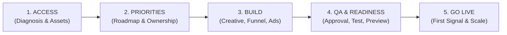

# Master Campaign & Product Launch Activation Workflow
*Adapted from the Growth Vault Visible Activation Standard for KusinaKita*

> **Guiding Principle**:  
> *"You shouldn't spend month one wondering what happens next. Turn diagnosis into a visible activation process: Access, Priorities, Build, QA, and Live. Clear ownership. Tangible progress. A defined next action."*



---

## Stage 1: ACCESS (Diagnosis & Technical Foundation)
* **Objective**: Audit existing assets, secure accounts, and set up tracking.
* **Lead Agent**: `ecc:planner` / `security-reviewer`
* **Checklist**:
  - [ ] **Market & USPTO Audit**: Online trademark clearance and domain confirmation.
  - [ ] **Ad & Pixel Setup**: Meta Pixel, Conversions API (CAPI), and GA4 event mapping.
  - [ ] **Payment & Merchant Connect**: Stripe / GCash / Maya API keys and webhooks.
  - [ ] **Honeypot Decoy Endpoints**: Provisioning hidden spam traps for bot isolation.

---

## Stage 2: PRIORITIES (Sprint Roadmap & Ownership Assignment)
* **Objective**: Assign workstream owners with explicit deliverables. No overlapping ambiguity.
* **Lead Agent**: `ecc:architect`

| Workstream | Owner Agent | Defined Next Deliverable | Status Gate |
|---|---|---|---|
| **Strategy & Positioning** | `brand-identity-agent` | Brand Guidelines, Voice Matrix, Offer Hook | Required |
| **Creative & Copy** | `ad-creative-agent` | 5 Ad Angles (PAS/AIDA), 15 FLUX Prompts | Required |
| **Funnel & Tech** | `funnel-architect-agent` | VSL Sales Page, 2-Step Checkout, OTO Flow | Required |
| **Paid Media & Lifecycle** | `ecc:tdd-guide` | Ad Testing Matrix, Welcome & Abandon Cart Mails | Required |

---

## Stage 3: BUILD ("Building the Work")
* **Objective**: Parallel generation of all campaign assets.
* **Execution Lanes**:
  1. **Creative & Visuals**:
     - 5 distinct ad angles targeting home cooks, carinderias, and foodpreneurs.
     - Production AI images (3D app icon, sizzling wok dishes, master cook portraits).
  2. **High-Converting Sales Funnel**:
     - Hero section, problem agitation, "Hindi Ito AI" credibility story.
     - Interactive food costing preview, value stack, 30-day risk guarantee.
     - 1-click impulse order bump (₱149 Negosyo Palamig formula).
  3. **Deception Security**:
     - Invisible CSS honeypot fields (`position: absolute; left: -9999px; aria-hidden="true"; tabindex="-1"`) to block spam bots without intrusive CAPTCHAs.

---

## Stage 4: QA & READINESS (The 4-Gate Quality Bar)
* **Objective**: No campaign goes live without passing all 4 gates.
* **Lead Agent**: `ecc:typescript-reviewer`, `ecc:e2e-runner`, `validator-agent`

```
[ APPROVAL ] ──> [ QA ] ──> [ PREVIEW ] ──> [ READY ]
```

* **Gate 1 (Creative Approved)**: Brand voice verified, claims compliant with ad policies, no hallucinated promises.
* **Gate 2 (Email QA Passed)**: Deliverability SPF/DKIM confirmed, CTA links valid, merge tags verified.
* **Gate 3 (Landing Page Preview)**: 375px mobile responsiveness verified, pricing math correct, order bump toggles seamlessly.
* **Gate 4 (Honeypot & Security Ready)**: Bot submission test triggered; form rejects decoy payload silently while human checkout succeeds.

---

## Stage 5: GO LIVE & THE FIRST SIGNAL
* **Objective**: Controlled deployment and immediate first-signal feedback loop.
* **Milestones**:
  - **Hour 0**: Campaign published; verification test purchase processed.
  - **Day 1–3 (First Signal)**:
    - *Metric Monitored*: Hook rate (>30%), CTR (>2.5%), Landing Page Conversion (>4%).
    - *Signal Assessment*: Positive / Neutral / Negative.
  - **Defined Next Action**:
    - **Positive**: Scale winning creative budget by 20% daily; launch Retargeting Ad Set.
    - **Neutral/Weak**: Swap ad hook variations (Test Angle 2 vs Angle 3); verify page speed.
